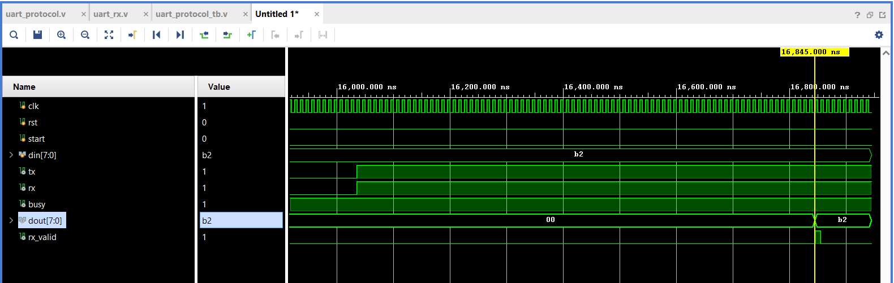

# UART Protocol Design Using Verilog HDL

## Project Overview

This project implements a complete UART (Universal Asynchronous Receiver Transmitter) communication protocol using Verilog HDL.

The design consists of two main modules:

- **UART Transmitter (TX):** Converts 8-bit parallel data into serial data.
- **UART Receiver (RX):** Converts incoming serial data back into 8-bit parallel data.

The transmitter and receiver communicate through a serial loopback connection. The received data is verified against the original transmitted data using a testbench.

## Features

- Parameterized clock frequency and baud rate.
- UART Transmitter and Receiver implementation.
- 8-bit data transmission.
- Start bit and Stop bit detection.
- Even parity generation and checking.
- 16x oversampling in UART Receiver.
- Finite State Machine (FSM) based architecture.
- Serial data transmission and reception.
- TX-RX loopback verification.
- Testbench with automatic data comparison.

## UART Frame Format

The UART communication frame consists of 11 bits:

| Field | Description |
|:---|:---|
| Start Bit | 1 bit (Logic 0) |
| Data Bits | 8 bits (LSB First) |
| Parity Bit | 1 bit (Even Parity) |
| Stop Bit | 1 bit (Logic 1) |

**Transmission Sequence:**

`START → D0 → D1 → D2 → D3 → D4 → D5 → D6 → D7 → PARITY → STOP`

## Design Architecture

### 1. UART Transmitter (TX)

The transmitter converts parallel input data into serial output data.

It uses a five-state Finite State Machine:

1. IDLE
2. START
3. DATA
4. PARITY
5. STOP

**Main Operations:**
- Detects the transmission request using the `start` signal.
- Loads 8-bit input data into an internal register.
- Generates the Start bit.
- Transmits data serially, starting with the LSB.
- Generates an even parity bit.
- Transmits the Stop bit.
- Indicates transmission status using the `busy` signal.

### 2. UART Receiver (RX)

The receiver converts serial input data into parallel output data.

It also uses a five-state Finite State Machine:

1. IDLE
2. START
3. DATA
4. PARITY
5. STOP

**Main Operations:**
- Detects the Start bit.
- Uses 16x oversampling for reliable data sampling.
- Samples the Start bit near its middle.
- Receives 8 data bits serially.
- Receives and checks the parity bit.
- Validates the Stop bit.
- Provides the received parallel data through `dout`.
- Generates the `rx_valid` signal when reception is successful.

## Parameters

The transmitter and receiver support configurable clock frequency and baud rate.

| Parameter | Default Value |
|:---|:---|
| Clock Frequency | 100 MHz |
| Baud Rate | 9600 |
| Data Width | 8 bits |
| Oversampling | 16x |
| Parity | Even Parity |
| Stop Bits | 1 |

## Project Structure

```text
UART-Protocol-Design-Verilog/
│
├── RTL/
│   ├── uart_tx.v
│   └── uart_rx.v
│
├── Testbench/
│   └── uart_protocol_tb.v
│
├── uart_waveforms.png
│
└── README.md
```
## Simulation and Verification

A loopback testbench is developed to verify UART transmission and reception.

The transmitter output (`tx`) is directly connected to the receiver input (`rx`).

### Test Configuration

| Parameter | Value |
|:---|:---|
| Clock Frequency | 160 Hz (simulation parameter) |
| Baud Rate | 1 |
| Input Data | `10110010` |
| Oversampling | 16x |

### Verification Steps

1. Apply reset to both transmitter and receiver.
2. Provide 8-bit input data to the transmitter.
3. Assert the `start` signal.
4. Transmit data serially through the TX module.
5. Receive the serial data through the RX module.
6. Check the parity and Stop bit.
7. Compare transmitted and received data.
8. Assert `rx_valid` when the received frame passes validation.

### Simulation Waveform

The following waveform shows the UART TX-RX loopback simulation.



### Simulation Result

| Signal | Expected / Observed Value |
|:---|:---|
| TX Input Data | `10110010` |
| RX Output Data | `10110010` |
| RX Valid | `1` |

**Result:** UART transmission and reception completed successfully. The received data matches the transmitted data.

## Tools Used

- Verilog HDL
- Xilinx Vivado
- RTL Simulation
- Digital Design and FSM Concepts

## Future Improvements

- Configurable parity modes (Even, Odd and None).
- Configurable data width.
- Multiple Stop bit support.
- Framing error detection.
- Parity error indication.
- FPGA hardware implementation.
- UART communication with external devices.

## Author

**Rohith Kumar**

Aspiring Design Verification Engineer
